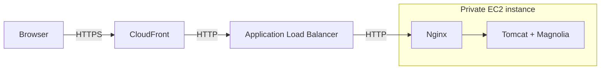

# Crescendo DevOps exam

Magnolia Community Edition on AWS, provisioned with Terraform. The deployment runs the [Travel Demo](https://docs.magnolia-cms.com/product-docs/getting-started-with-magnolia/demo/travel-demo-for-developers/) on a private EC2 instance, with HTTPS access through CloudFront.

[Open Magnolia](https://d2xpkbus8fu2t7.cloudfront.net/magnoliaAuthor/) · [Check readiness](https://d2xpkbus8fu2t7.cloudfront.net/magnoliaAuthor/.rest/health/ready)

## Architecture

The network spans two availability zones, with two public and two private subnets. One NAT Gateway provides outbound access; AWS Systems Manager provides instance access for troubleshooting.

Terraform state lives in a versioned S3 bucket with locking. GitHub Actions checks formatting and validation, and trusted pull requests run a real Terraform plan using temporary AWS credentials. Operators review and apply deployments manually.

## Scope and tradeoffs

This is a development environment with one instance. Content survives instance reboots; replacing the instance automatically reinstalls everything. Old data is lost, there are no CMS backups or automatic failover.

Browser traffic uses HTTPS. Connections from CloudFront to the load balancer and from the load balancer to the instance use HTTP.

## Documentation

- [Architecture](docs/architecture.md): components, network boundaries, application provisioning, and CI design.
- [Setup and operations](docs/operations.md): prerequisites, deployment, checks, recovery, and teardown.
- [Walkthrough and evidence](docs/submission.md): verified behavior and screenshots.
