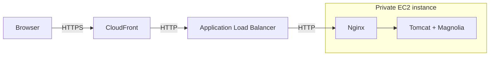

# Crescendo DevOps exam

Magnolia Community Edition on AWS, provisioned with Terraform. The deployment runs the [Travel Demo](https://docs.magnolia-cms.com/product-docs/getting-started-with-magnolia/demo/travel-demo-for-developers/) on a private EC2 instance, with HTTPS access through CloudFront.

[Open Magnolia](https://d2xpkbus8fu2t7.cloudfront.net/magnoliaAuthor/) · [Check readiness](https://d2xpkbus8fu2t7.cloudfront.net/magnoliaAuthor/.rest/health/ready)

## Architecture



The network spans two availability zones, with two public and two private subnets. One NAT Gateway provides outbound access; AWS Systems Manager provides instance access for troubleshooting.

Terraform state lives in a versioned S3 bucket; locking prevents concurrent operations from conflicting. GitHub Actions runs `terraform fmt`, `validate`, and, for eligible same-repository pull requests, `plan` using temporary AWS credentials. Plans preview AWS changes; operators apply deployments manually.

## How to run

Prerequisites: Git, Terraform `~> 1.16.6`, AWS CLI v2, Python 3, and AWS access through profile `default` in `eu-central-1`. The configuration targets account `317399646022` and uses the existing [remote state backend](docs/operations.md#backend-state).

From the repository root, for the existing backend:

```sh
export AWS_PROFILE=default
umask 077
mkdir -p build/operations
terraform -chdir=infra init -lockfile=readonly
terraform -chdir=infra fmt -check -recursive
terraform -chdir=infra validate
python3 scripts/check-provisioning.py
terraform -chdir=infra plan -out=../build/operations/deploy.tfplan
# Review the proposed changes before applying this saved plan.
terraform -chdir=infra apply ../build/operations/deploy.tfplan
terraform -chdir=infra output
```

Allow several minutes for installation, then open `author_url`; `readiness_url` must return HTTP 200. The Travel page is `/magnoliaAuthor/travel.html` and requires login. Use `superuser` with the initial password generated on the instance at `/etc/magnolia/superuser-password`, accessible through Systems Manager (CLI sessions require the Session Manager plugin).

CI uses GitHub OIDC and three repository variables: `AWS_PLAN_ROLE_ARN`, `TF_STATE_LINEAGE`, and `TF_STATE_IDENTITIES_SHA256`. See [CI configuration](docs/operations.md#ci-configuration).

## Assumptions and limitations

This is a development environment with one instance. Content survives instance reboots. Replacing the instance automatically reinstalls Magnolia and deletes all CMS content. There are no CMS backups or automatic failover.

Browser traffic uses HTTPS. Connections from CloudFront to the load balancer and from the load balancer to the instance use HTTP. One NAT Gateway serves both zones. This is an author-only demo with embedded storage and no separate public publishing instance. AWS charges continue while the stack is running; see [teardown](docs/operations.md#teardown).

## Documentation

- [Architecture](docs/architecture.md): components, network boundaries, application provisioning, and CI design.
- [Operations](docs/operations.md): deployment, checks, troubleshooting, state recovery, and teardown.
- [Walkthrough and evidence](docs/submission.md): verified behavior and screenshots.
