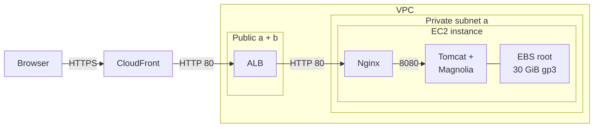
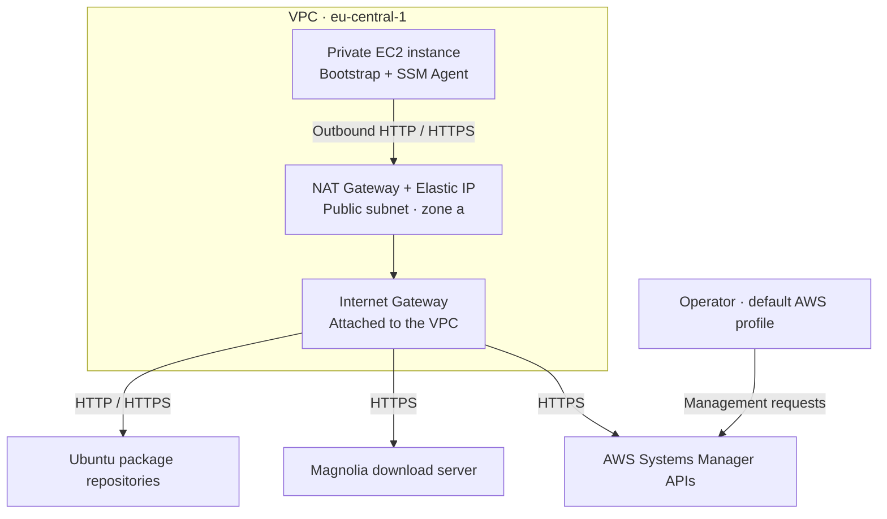
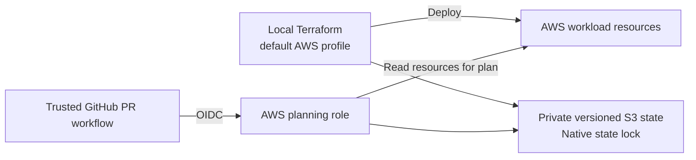

# Architecture

Magnolia Community Edition runs on one private EC2 instance in AWS region `eu-central-1`. Users access the CMS over HTTPS through CloudFront and an Application Load Balancer (ALB). Nginx receives requests on the instance and passes them to Magnolia, which runs in Tomcat.

Terraform manages the infrastructure in two directories. [`infra/`](../infra/) defines the network, application host, load balancer, and CloudFront distribution. [`bootstrap/`](../bootstrap/) defines the S3 bucket that stores Terraform state and the AWS role used by GitHub Actions to plan changes.

### Browser requests

CloudFront receives the browser's HTTPS request and forwards it to the ALB over HTTP on port 80. The ALB sends the request to Nginx, also on port 80. Nginx then forwards it to Tomcat on the same instance at `127.0.0.1:8080`. Tomcat accepts connections only from within that instance.

Security groups restrict which systems can make these connections. The ALB accepts traffic only from AWS's list of CloudFront origin-facing IP ranges, called a managed prefix list. The instance accepts port 80 only from the ALB security group. HTTPS encryption ends at CloudFront; the connections from CloudFront to the ALB and from the ALB to Nginx use unencrypted HTTP.

The ALB spans two availability zones. Magnolia runs on a single instance in zone a, and the private subnet in zone b has no instance. The application therefore depends on that one host. Its root disk holds the CMS data: rebooting keeps the data, while replacing the instance deletes it and creates a fresh Magnolia repository.

### Outbound access and administration

During setup, the instance downloads packages from Ubuntu repositories and the Magnolia bundle from its download server. It also runs the AWS Systems Manager (SSM) Agent, which connects to AWS over HTTPS so operators can manage the private instance.

Both private subnets send outbound internet traffic through one NAT Gateway in zone a. The gateway uses an Elastic IP and reaches the internet through the VPC's Internet Gateway.

Operators use Systems Manager to access the instance. The SSM Agent initiates the connections, so the instance needs neither a public IP address nor an inbound management port such as SSH.

### Terraform and PR checks

Operators deploy from their local machine using the `default` AWS profile. GitHub Actions checks trusted pull requests (PRs) by reading the existing AWS resources and Terraform state, then producing a plan. Its AWS role can acquire and release the state lock but cannot apply changes. The separate bootstrap configuration creates the state bucket and planning role.

## Components

| Component | Configuration |
| --- | --- |
| Network | VPC `10.42.0.0/16`; public and private subnets in `eu-central-1a` and `eu-central-1b` |
| Outbound routing | One NAT Gateway in public subnet `a`, shared by both private subnets |
| Application host | One private `t3.medium`, 2 vCPUs and 4 GiB RAM, Ubuntu Server 24.04 LTS amd64, IMDSv2 required |
| Storage | One 30 GiB gp3 root volume; deleted on termination; encryption follows AWS account and AMI defaults |
| Runtime | Magnolia CE Travel Demo 6.3.27, bundled Tomcat 9.0.121, OpenJDK 17, Nginx |
| Health check | `/magnoliaAuthor/.rest/health/ready`, exact HTTP 200; 30-second interval, 5-second timeout, healthy/unhealthy thresholds 2/3 |
| Administration | Systems Manager through outbound HTTPS; no public instance IP or inbound SSH |

The Amazon Machine Image (AMI) release is fixed by `ubuntu_ami_name`, so publishing a new Ubuntu image does not automatically trigger instance replacement. The instance uses standard CPU credits to avoid surplus-credit charges; this can slow setup or sustained CPU work. Java's maximum heap is 2 GiB.

## Request handling

Users connect through the hostname and HTTPS certificate supplied by CloudFront. CloudFront redirects HTTP requests to HTTPS. Caching is disabled, including error caching for the status codes CloudFront allows us to configure. Nginx also sets `Cache-Control: no-store, private` on responses.

CloudFront forwards all browser request headers, cookies, and query strings, and allows all seven supported HTTP methods. It adds `CloudFront-Forwarded-Proto` to record the browser's connection protocol. Nginx uses this header to tell Tomcat that the original request used HTTPS, even though the intervening connections use HTTP. This keeps application redirects on HTTPS and preserves Secure session cookies.

Nginx forwards requests under `/magnoliaAuthor/` to Tomcat at `127.0.0.1:8080`. Requests to `/` redirect to `/magnoliaAuthor/`.

The ALB accepts traffic only from CloudFront, without restricting access to our specific distribution.

## Provisioning and data lifecycle

On a new instance, cloud-init runs the setup script to install Java and Nginx, download the fixed Magnolia bundle, verify its checksum, and configure the author application. The templates live in [`infra/templates/`](../infra/templates/). Java and Nginx patch versions come from the Ubuntu repositories. Magnolia and its bundled Tomcat use fixed versions.

Magnolia installs its modules and initializes the demo automatically. Systemd runs Magnolia in the foreground and checks readiness during startup. The setup script starts Nginx after Magnolia is ready. Magnolia has a 1,500-second startup timeout; if the process fails, systemd restarts it after a delay and limits repeated restart attempts. Initial deployment and instance replacement have both been verified without manual application setup.

The application is installed under `/opt/magnolia`. CMS content is stored in the embedded Jackrabbit/H2 repository under `/var/lib/magnolia`, alongside other application data. These directories share the instance's root disk and survive a reboot.

Changing the instance's user data (its startup configuration) or AMI can trigger replacement. Replacement deletes the root disk and installs Magnolia with fresh content. This data loss is intentional for the exam environment. There is no separate database, CMS content backup, or public publishing instance.

## Terraform State and CI

Terraform stores the application's infrastructure state in a private, versioned S3 bucket. Native S3 locking prevents concurrent Terraform operations from changing that state at the same time. The separate bootstrap configuration creates the bucket and GitHub planning role. It keeps its own state locally, with a restricted recovery copy in S3. Restoring Terraform state recovers the record of managed infrastructure; it does not restore CMS content.

Every pull request runs formatting and validation checks for both Terraform configurations without AWS credentials. Eligible trusted pull requests from the same repository also call a reusable planning workflow from `main`. That workflow uses GitHub's OpenID Connect (OIDC) identity to obtain temporary AWS credentials. AWS Identity and Access Management (IAM) restricts access to the expected repository identity, pull-request context, and workflow. Fork pull requests receive formatting and validation checks only.

The planning role can read the application's AWS resources and Terraform state, and can create and delete the specific S3 object used as the state lock. It cannot deploy changes, write application infrastructure state, read bootstrap state, or use Systems Manager. Before planning, CI checks the state's lineage and resource identities against the recorded baseline to confirm that it is using the expected state and managed resources. It publishes only action counts and status; saved plans and detailed state remain private. Operators apply deployments manually.

This CI design trusts repository administrators and authors of eligible pull requests from the same repository. The last recorded repository check found `main` unprotected, so operators must inspect the checks and obtain the required review before merging.

## Availability limits

The application has one instance in zone `a`, so maintenance, replacement, or instance failure interrupts service. Having an ALB in two zones does not provide a second application host.

Both private subnets depend on the NAT Gateway in Bzone a. A NAT or zone outage removes outbound internet and Systems Manager access, and outbound traffic from the private subnet in zone b must cross zones. There is no automatic instance or NAT failover.

See [setup and operations](operations.md) for deployment and recovery, and [walkthrough evidence](submission.md) for the verified reboot, replacement, browser, and CI behavior.
