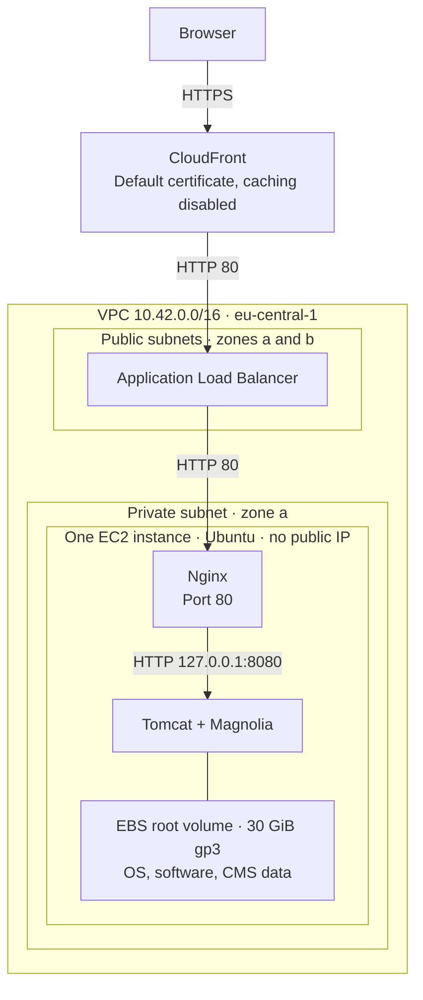
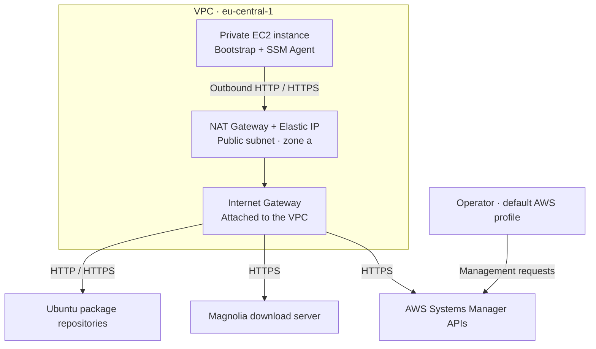
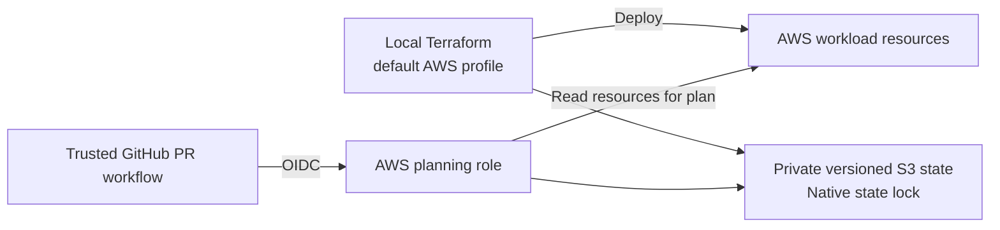

# Architecture

The workload runs in `eu-central-1`. Terraform defines the application infrastructure in [`infra/`](../infra/) and the state backend and GitHub identity in [`bootstrap/`](../bootstrap/).

### Browser requests

The ALB accepts port 80 only from the CloudFront origin-facing prefix list; EC2 accepts port 80 only from the ALB security group. Tomcat listens on loopback inside the same instance. TLS terminates at CloudFront; both origin hops use HTTP.

The ALB spans two zones, but the application runs in one zone. The second private subnet in zone b has no instance. Reboot retains the root disk. Instance replacement deletes it and rebuilds Magnolia with a fresh repository.

### Outbound access and administration

Ubuntu packages, the Magnolia installer, and Systems Manager are external destinations contacted by the instance. Downloads happen during provisioning; the SSM Agent uses outbound HTTPS for management.

Both private subnets route outbound traffic through the single NAT Gateway in zone a. Systems Manager carries management traffic over connections initiated by the SSM Agent; EC2 needs no inbound management port.

### Terraform and PR checks

Deployment runs locally. Trusted PR checks read AWS resources and workload state to produce a plan; the role can manage the state lock but cannot apply infrastructure changes. The separate bootstrap Terraform root owns the state bucket and CI identity.

## Components

| Component | Configuration |
| --- | --- |
| Network | VPC `10.42.0.0/16`; public and private subnets in `eu-central-1a` and `eu-central-1b` |
| Outbound routing | One NAT Gateway in public subnet `a`, shared by both private subnets |
| Application host | One private `t3.medium`, 2 vCPUs and 4 GiB RAM, Ubuntu Server 24.04 LTS amd64, IMDSv2 required |
| Storage | One 30 GiB gp3 root volume; deleted on termination; encryption follows AWS account and AMI defaults |
| Runtime | Magnolia CE Travel Demo 6.3.27, bundled Tomcat 9.0.121, OpenJDK 17, Nginx |
| Health check | `/magnoliaAuthor/.rest/health/ready`, exact HTTP 200; 30-second interval, 5-second timeout, healthy/unhealthy thresholds 2/3 |
| Administration | Systems Manager through outbound HTTPS; no public instance IP or inbound SSH |

The AMI release is pinned through `ubuntu_ami_name`, preventing a newly published image from silently replacing the instance. Standard CPU credits avoid surplus-credit charges but can slow initialization or sustained CPU work. The JVM has a 2 GiB maximum heap.

## Request handling

CloudFront uses its assigned hostname and default certificate, redirects HTTP viewers to HTTPS, and disables caching, including configurable error caching. It forwards all viewer headers, cookies, and query strings, allows all seven supported HTTP methods, and adds the viewer-protocol header. Nginx sets `Cache-Control: no-store, private` on responses.

The ALB accepts port 80 only from the CloudFront origin-facing prefix list. EC2 accepts port 80 only from the ALB security group. Nginx proxies the author context to Tomcat on `127.0.0.1:8080` and restores the viewer protocol from `CloudFront-Forwarded-Proto`, preserving HTTPS redirects and Secure session cookies. `/` redirects to `/magnoliaAuthor/`.

The prefix list admits CloudFront origin traffic generally; it does not identify this distribution. Origin TLS, distribution-specific origin authentication, WAF rules, and CloudFront access logging are outside the current scope. CloudFront supplies the managed security headers policy; an application-specific Content Security Policy is deferred.

## Provisioning and data lifecycle

Cloud-init installs Java and Nginx, downloads the pinned Magnolia bundle, verifies its checksum, and configures one author webapp. The templates live in [`infra/templates/`](../infra/templates/). Java and Nginx patch versions follow the Ubuntu repositories; Magnolia and bundled Tomcat are pinned.

Magnolia installs its modules and initializes the demo automatically. Systemd runs Magnolia in the foreground, waits for readiness, then starts Nginx. Startup allows 1,500 seconds; failed processes restart with a delay and a bounded start rate. Initial deployment and replacement have been verified without manual application setup.

The application lives under `/opt/magnolia`. The embedded Jackrabbit/H2 repository and other mutable data live under `/var/lib/magnolia` on the same root disk. Reboots reuse those directories. Changing user data or the AMI can replace the instance, deleting its root disk and initializing fresh content. There is no separate database, content backup, or public publishing instance.

## State and CI

The workload uses a private, versioned S3 backend with native locking. The separate bootstrap root creates the bucket and GitHub OIDC planning identity, retaining local state with a restricted S3 recovery copy. State backups recover infrastructure tracking; they do not recover CMS content.

Every pull request runs formatting and validation for both Terraform roots without AWS credentials. Trusted same-repository pull requests call a reusable planning workflow from `main`. GitHub OIDC issues temporary credentials; IAM binds them to the repository identity, pull-request context, and that workflow. Fork pull requests receive formatting and validation only.

The planning role reads the workload and its state and can manage the exact state-lock object. It cannot deploy, write workload state, read bootstrap state, or use Systems Manager. CI verifies the state lineage and managed-resource identities before planning and publishes only action counts and status. Saved plans and detailed state remain private. Deployment is a manual operator action.

Repository administrators and authors of trusted same-repository pull requests remain within the CI trust boundary. The last recorded repository check found `main` unprotected; inspect actual checks and obtain the required review before merging.

## Availability limits

The ALB spans two zones, but the application has one instance in zone `a`. Maintenance, replacement, or instance failure interrupts service. Both private subnets depend on one NAT Gateway in that zone; a NAT or zone outage removes outbound and Systems Manager access. Traffic from the second zone crosses zones. There is no automatic instance or NAT failover.

See [setup and operations](operations.md) for deployment and recovery, and [walkthrough evidence](submission.md) for the verified reboot, replacement, browser, and CI behavior.
