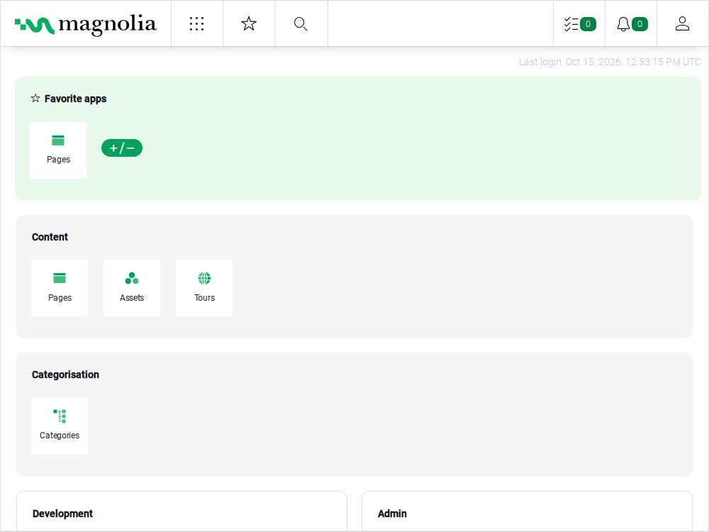

# Submission and walkthrough

The development application runs at [the CloudFront author URL](https://d2xpkbus8fu2t7.cloudfront.net/magnoliaAuthor/). The stack stays running for review. Use the [README](../README.md) for setup, configuration, operations, troubleshooting, and teardown; [the plan](plan.md) records acceptance and validation evidence.

## Walkthrough notes

1. Open the CloudFront URL and show the styled Magnolia login page. The unauthenticated author response is HTTP 401 by design. The readiness URL must return exact HTTP 200 after Magnolia finishes initialization.
2. Explain the diagram in the README: CloudFront terminates browser HTTPS, forwards all application request data with caching disabled, and reaches the two-zone ALB over HTTP. ALB-sourced requests reach Nginx on one private EC2 instance, then Tomcat on loopback. The instance has no public IP or inbound SSH. Operators use Systems Manager through NAT.
3. Show the lifecycle evidence below. The OS, application, and embedded Jackrabbit/H2 repository share one 30 GiB gp3 root volume. Reboot keeps the volume and content. Terraform replacement deletes the volume and initializes a new demo repository. Rebuilds need no manual application setup.
4. Show the P07 PR checks. Formatting and validation cover both roots without AWS credentials. A trusted same-repository PR uses GitHub OIDC and a read-only planning role, checks state lineage and all managed identities, and runs a real workload plan. CI can manage only the native lock object; it cannot deploy or write workload state. Deployments remain manual, using an inspected saved plan.
5. Explain state separation: `infra/` uses versioned S3 state and native locking. `bootstrap/` owns the backend and CI role, with restricted local state and a separate versioned recovery copy. State recovery does not recover CMS content.
6. Close with the tradeoffs: one application instance and one NAT Gateway, embedded persistence, no content backup or automatic failover, HTTP origin links, and standard CPU credits that can slow startup. CloudFront's origin-facing prefix list admits other CloudFront distributions too; this deployment has no distribution-specific origin authentication. These are development constraints, not production availability or security claims.

Use only an authorized on-instance authentication session for a live demo. The P04/P05 exception keeps credentials and cookies in memory on EC2 and sends them only to the verified CloudFront HTTPS origin. Do not reveal the local password file, browser storage, request headers, response HTML, or application logs while recording. The screenshots contain only rendered application content; no trace, HAR, video, or browser storage export is needed.

## Lifecycle evidence

The machine-readable [sanitized results](evidence/p07-lifecycle.json) record the test page, JCR identifier, content checks, and boot IDs. The page was created through Magnolia's [Nodes API](https://docs.magnolia-cms.com/product-docs/6.3/developing/api/nodes-and-properties-apis/nodes-api/) over CloudFront HTTPS. It is disposable exam content, created specifically to prove the intended disk lifecycle.

| Check | Evidence |
| --- | --- |
| Created page | `/travel/p07-lifecycle-20261015`, title `P07 lifecycle verification 2026-10-15` |
| Content marker | `Created before reboot; intentionally discarded on instance replacement.` |
| JCR identifier | `3f86dd01-d946-4fe6-8e84-3780df71ca25` |
| Reboot | Same title, marker, and identifier; changed boot ID; authenticated AdminCentral, readiness 200, logout, and healthy ALB target |
| Inspected saved plan | Only `aws_instance.magnolia` and `aws_lb_target_group_attachment.magnolia` delete/create; 31 other managed resources unchanged |
| Replacement instance | `i-03e2b17589905593d` -> `i-025b0f60830e52130` |
| Root volume | `vol-0507e0dd3d123a7d3` deleted; replacement `vol-05d3b44af9b7d13fa`, 30 GiB gp3, delete on termination, AWS/AMI encryption defaults |
| Fresh CMS | Unattended cloud-init completed; test page absent with authenticated 404; Travel sample and AdminCentral accessible through the same CloudFront URL |
| Recovery | New target healthy, only new target registered, CloudFront Deployed, standard CPU credits; Magnolia startup 399,990 ms, services active about eight minutes after launch |
| Local verification | Baseline and final workload plans exit 0; final bootstrap plan exit 0; both roots validate; formatting, pinned archive/provisioning, Python syntax, documentation links, and identity-guard rejection checks pass |
| State | Original lineage preserved, serial 42 -> 44, same 33 managed addresses, exactly two managed IDs changed |
| CI baseline | Updated `TF_STATE_IDENTITIES_SHA256` only after verifying those changes, using the workflow's canonical algorithm |

The root volume and implicit primary network interface belong to `aws_instance.magnolia`; both receive new IDs with the new host and are not separate Terraform resource addresses. The instance ARN, private DNS, and private IP also follow the new instance. The target attachment's ID changes because it includes the instance ID. The instance ID/private-IP outputs change too. CloudFront, its hostname, ALB, target group, network, IAM identities, and backend remain the same. The raw post-apply snapshot also refreshes previously stale inline ALB ingress attributes and normalizes empty CloudFront fields/unused error-response codes. Those ancillary values exactly match the refreshed pre-replacement no-change plan; they are not additional infrastructure changes. Detailed state, saved plans, and logs stay in ignored storage with directories mode `0700` and files mode `0600`.

## Screenshots through CloudFront

These screenshots come from authenticated, nonpersistent Chromium sessions on the replacement EC2 instance. The browser guard verified this stack's CloudFront HTTPS origin for every document navigation. AdminCentral, Travel content/images, session reuse, anonymous isolation, and logout passed. Secure/HttpOnly session cookies stayed in memory on EC2. Optional external fonts/widgets were blocked; they are outside the tested origin.

## PR validation

[PR #2](https://github.com/amanya/Crescendo-DevOps-exam/pull/2) is open for review. [Source-validation run 38739045709](https://github.com/amanya/Crescendo-DevOps-exam/actions/runs/38739045709) passed both actual jobs at `4e5c110`: formatting/validation and the trusted OIDC remote-state plan. CI verified the original lineage and all 33 current managed IDs, then reported plan exit 0 with 33 no-op actions. Manual review inspection found no submitted reviews and no requested reviewers. Check both jobs on the latest PR head again before merging; the handoff documentation commit reruns the same workflow.

## Submission access and decisions

The exam requests a public repository. [amanya/Crescendo-DevOps-exam](https://github.com/amanya/Crescendo-DevOps-exam) remains private at the user's explicit request. The user must obtain acceptance of private submission or authorize a different visibility decision. An anonymous reviewer cannot inspect its source, PR, checks, or screenshots hosted in the repository. The CloudFront endpoint is publicly reachable, but authenticated access still requires the authorized demo process.

The user will manually invite `tristanamargo-crescendo` and `jeremysummers`. No invitations or review requests were sent. Reviewer access and any required acceptance remain outstanding submission requirements.

Branch protection is unavailable on the current private-repository GitHub plan. Inspect both actual P07 PR checks and the review state manually before merging. Do not change visibility, upgrade the plan, merge the PR, or tear down the stack as part of submission preparation. Final PR review and the user's final submission remain outstanding. Until the access requirement is resolved, the plan keeps P07 In progress even after its technical checks pass.
