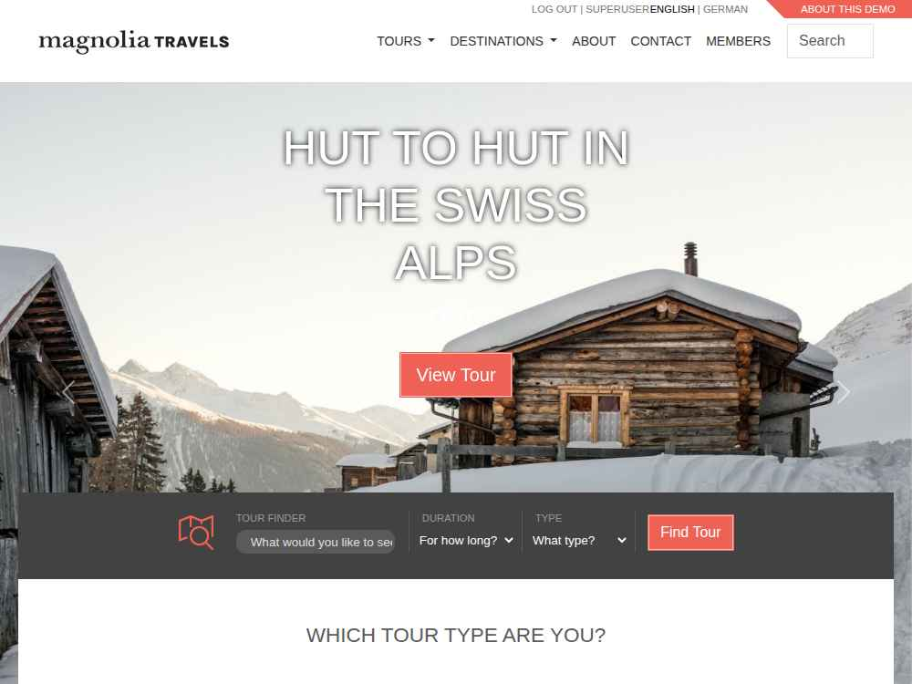

# Submission and walkthrough

[Open Magnolia](https://d2xpkbus8fu2t7.cloudfront.net/magnoliaAuthor/) · [Check readiness](https://d2xpkbus8fu2t7.cloudfront.net/magnoliaAuthor/.rest/health/ready)

Magnolia Community Edition runs on a private EC2 instance, provisioned with Terraform and accessible through CloudFront HTTPS. The environment remains running for review. See the [README](../README.md#how-to-run) for setup and login instructions.

## Walkthrough

1. Open Magnolia and demonstrate AdminCentral and the Travel demo. The login page returns HTTP 401 before authentication; readiness returns HTTP 200 when the application is ready.
2. Follow the [architecture diagrams](architecture.md) from CloudFront through the load balancer and Nginx to Tomcat/Magnolia. Explain private instance access through Systems Manager.
3. Review the reboot and replacement results below, then show the [successful pull-request checks](https://github.com/amanya/Crescendo-DevOps-exam/actions/runs/38741770941). Formatting, validation, and an AWS Terraform plan passed. Deployments remain manual.

## Lifecycle evidence

Verified on 2026-10-15:

| Check | Result |
| --- | --- |
| Reboot | Created CMS content retained the same title, content, and identifier after reboot. |
| Instance replacement | Terraform deleted the old root volume and automatically installed a fresh Magnolia demo without manual application setup. The test content was absent, as intended. |
| Application recovery | AdminCentral and Travel content worked through the same CloudFront URL. Readiness returned HTTP 200 and the load balancer target was healthy. |
| Terraform state | Only the instance and its target attachment changed resource identities. Final infrastructure and backend plans reported no changes. |

The [recorded results](evidence/lifecycle.json) contain the detailed checks.

## Screenshots through CloudFront

AdminCentral and the Travel demo after instance replacement:

## Limitations

This development environment has one application instance, one NAT Gateway, embedded CMS storage, and no CMS backups or automatic failover. Instance replacement discards all CMS content. Browser traffic uses HTTPS; origin connections use HTTP. CloudFront access restrictions do not identify this distribution exclusively. See [operations](operations.md) for troubleshooting and teardown.
